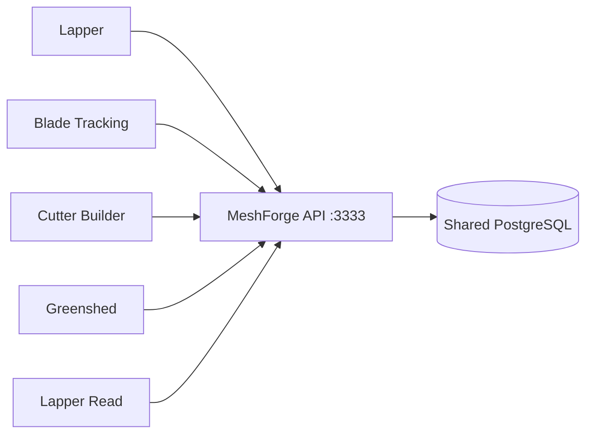

# One API for every MeshForge application

The running backend is the meshforge-server Nx project at
apps/server. Lapper is a feature module of this API. There is one
Nest application, one listener on port 3333, one TypeORM DataSource and one
PostgreSQL database. The former lapper-api application and Compose service have
been removed.



## Authentication and feature boundaries

POST /api/v1/auth/email/login accepts email/password and returns accessToken
and refreshToken. GET /api/v1/auth/me validates an access token; GET
/api/v1/auth/refresh rotates a refresh token. One access token authorizes every
feature according to the current account's role and department. Expiration,
inactive/deleted accounts, token purpose, password changes and authVersion
revocation are enforced by the same strategy.

The API has a default authentication guard. Login, recovery, verification and
health routes opt out explicitly; refresh still requires the refresh-token
guard. Manufacturing roles and department edit checks are preserved. Lapper's
setup permissions apply only to its controllers, so they do not deny authorized
manufacturing operations. User CRUD belongs to the existing shared users service.

Lapper controllers depend on service contracts. PostgreSQL implementations use
the same DataSource as manufacturing. Obsolete Lapper ORM registration modules,
authentication providers, database configuration and server entry point are
removed. No second server, signing key or database pool is used for Lapper.

Both the entry point and HTTP acceptance suite use configureApi: URI versioning,
serialization, strict DTO validation and error handling have one configuration.
Duplicate controller routes are checked by acceptance tests.

## Upgrade the existing non-production installation

1. Stop Lapper Read and preserve its checkpoint/state files.
2. Extract the source ZIP into a new empty folder, or clone the branch containing
   this change. Copy the host's existing .env into the new checkout.
   Keep the PostgreSQL volume and existing data. Do not overlay the ZIP on an old
   source tree: obsolete API project files must not remain in the workspace.
3. Keep DATABASE_SYNCHRONIZE=false. The API uses the existing JWT_ACCESS_SECRET
   and JWT_REFRESH_SECRET from root `.env`. LAPPER_JWT_SECRET and LAPPER_API_PORT
   are obsolete. Configure LAPPER_TIME_ZONE and SCANNER_* in that same `.env`
   when needed. There is no `manufacturing/.env` requirement.
4. From the repository root run:

```sh
docker compose up -d --build --remove-orphans
docker compose ps
```

The unchanged project name and PostgreSQL service keep the existing volume.
--remove-orphans retires the former lapper-api container. Do not remove volumes.
The explicit equivalent is `docker compose --env-file .env -f compose.yml up -d --build --remove-orphans`.

5. Verify http://YOUR-HOST:3333/api/v1/health/ready. Sign in again in each web
application; tokens issued by the former Lapper server use a different contract.

6. Start the Lapper Read collector container and connect it in Admin >
Collector Tokens:

```sh
docker compose --profile collectors up -d --build lapper-read
```

Collector checkpoints stay in place. See the
[collector README](../apps/lapper-read-py/README.md) for its settings and the
licensed FANUC library it needs.

The database cleanup already applied by the owner remains valid. Its five
integrity migrations keep their original checksums. One additional migration
initializes the canonical gearset table/type on fresh installations; existing
gearset data is retained. No database replacement, reset, legacy reimport or
ratio recalculation is required.

## Development and verification

Clone the main branch:

```sh
git clone --branch main https://github.com/ryan1393/GearApps.git
```

Run npm commands at the root. npm run serve:api starts the sole API; all four
client proxies target localhost:3333. The only API environment is .env.
The shared authentication response and principal contracts live in libs/shared/domain.

CI runs the collector's tests through Nx and also boots the compiled API
against a fresh PostgreSQL service, including both initialization jobs and a
read-only integrity audit.

On an isolated cleaned MeshForge restore whose name ends in _lapper_test, set
DATABASE_HOST/PORT/USERNAME/PASSWORD/NAME and MESHFORGE_ALLOW_TEST_ACCOUNTS=YES,
then run npm run test:lapper-postgres. This starts the actual combined AppModule
with its production HTTP configuration. It checks shared authentication,
revocation, role/department boundaries, manufacturing and Lapper routes, lack of
route collisions, collector writes and public-row preservation after fixture cleanup.
It deliberately leaves test history in lapper and must not use the running database.

Run npm run db:audit against a chosen database for read-only structural checks.
CI (`.github/workflows/ci.yml`) runs the unit, deployment, contract, build and
collector checks on every change.
